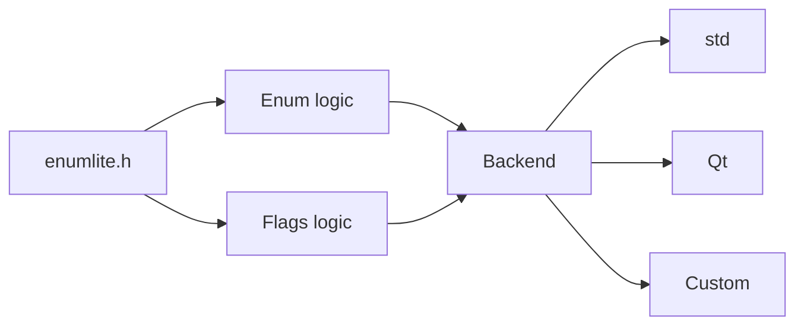

# enumlite

A lightweight, header-only C++20 library for defining strongly-typed enums and bitmask flags with configurable string backends.

`enumlite` reduces the boilerplate required to define enums and flags while providing:

* Strongly-typed `enum class` types
* Automatic enum metadata
* String conversion
* String parsing
* Value validation
* Bitmask flag operators
* Flag string serialization and parsing
* Name/value collections
* String normalization
* Configurable string backends
* Standard C++ backend included
* Optional Qt backend
* Custom backend support
* No runtime registration
* Header-only design

The core library is completely independent from Qt or any other string framework.


## Features

### Enums

Define an enum with a single macro:

```cpp
DEFINE_ENUM(
    Color,
    int,
    RED,   1,
    GREEN, 2,
    BLUE,  4
);
```

This generates:

```cpp
enum class Color : int
{
    NONE = 0,
    RED = 1,
    GREEN = 2,
    BLUE = 4
};
```

as well as helper functions and metadata:

```cpp
Color_names
Color_values
Color_members

Color_to_str(...)
Color_from_str(...)
Color_is_valid(...)
```

### Flags

Define a bitmask enum just as easily:

```cpp
DEFINE_FLAGS(
    Permissions,
    unsigned,
    READ,  1U,
    WRITE, 2U,
    EXEC,  4U
);
```

> same generation as enums

The following operators are generated automatically:

```cpp
|
&
^
~
|=
&=
^=
```

Example:

```cpp
auto permissions =
    Permissions::READ |
    Permissions::WRITE;

if (Permissions_has_flag(
        permissions,
        Permissions::READ))
{
    // READ is enabled
}
```


## Requirements

* C++20 or newer
* A C++20-compatible compiler:

  * GCC
  * Clang
  * MSVC
* No external dependency when using the standard backend


# Installation
see 


# Basic Usage

Include the library:

```cpp
#include <enumlite/enumlite.h>
```

Then define an enum:

```cpp
DEFINE_ENUM(
    Color,
    int,
    RED,   1,
    GREEN, 2,
    BLUE,  4
);
```

## Enum to string

```cpp
auto text = Color_to_str(Color::RED);
```

With the standard backend, the return type is:

```cpp
std::string
```

For example:

```cpp
std::cout << Color_to_str(Color::RED);
```

outputs:

```
RED
```


## String to enum

```cpp
auto color = Color_from_str("GREEN");
```

The result is:

```cpp
Color::GREEN
```

Unknown values return:

```cpp
Color::NONE
```

Example:

```cpp
auto color = Color_from_str("unknown");

if (color == Color::NONE)
{
    // Invalid or unknown value
}
```


# String Normalization

`enumlite` performs normalization when comparing enum names.

## Case insensitive

These values are equivalent:

```
RED
red
Red
rEd
```

All match:

```cpp
Color::RED
```


## `_` and `-` are equivalent

For:

```cpp
DEFINE_ENUM(
    MyEnum,
    int,
    MY_VALUE, 1
);
```

all of these match:

```
MY_VALUE
MY-VALUE
my_value
my-value
My_Value
```


## Leading and trailing `_`

A leading underscore is ignored:

```
_VALUE
VALUE
```

A trailing underscore is removed:

```
VALUE_
VALUE
```

This is useful for enum identifiers that conflict with C++ keywords or project naming conventions.

For example:

```cpp
DEFINE_ENUM(
    Keyword,
    int,
    class_, 1,
    struct_, 2
);
```

The string representation is:

```
class
struct
```


# Enum Metadata

`DEFINE_ENUM` also generates collections describing the enum.

For:

```cpp
DEFINE_ENUM(
    Color,
    int,
    RED,   1,
    GREEN, 2,
    BLUE,  4
);
```

the following are available:

```
Color_names
Color_members
Color_values
```


## `Color_names`

Contains the names of all enum values, including `NONE`:

```cpp
for (const auto& name : Color_names)
{
    std::cout << name << '\n';
}
```

Output:

```
NONE
RED
GREEN
BLUE
```


## `Color_members`

Contains the corresponding enum values:

```cpp
for (auto value : Color_members)
{
    std::cout << Color_to_str(value) << '\n';
}
```


## `Color_values`

Contains the comma-separated list of values:

```cpp
std::cout << Color_values;
```

Output:

```
NONE, RED, GREEN, BLUE
```


# Validation

Use the generated validation function:

```cpp
if (Color_is_valid(color))
{
    // Valid Color value
}
```

Example:

```cpp
Color color =
    static_cast<Color>(123);

if (!Color_is_valid(color))
{
    // Invalid value
}
```


# Flags

Flags use the same basic API.

Define them with:

```cpp
DEFINE_FLAGS(
    Permissions,
    unsigned,
    READ,  1U,
    WRITE, 2U,
    EXEC,  4U
);
```

This generates:

```cpp
enum class Permissions : unsigned
{
    NONE = 0,
    READ  = 1,
    WRITE = 2,
    EXEC  = 4,
    ALL   = 7
};
```


## Combining Flags

```cpp
auto permissions =
    Permissions::READ |
    Permissions::WRITE;
```

The result contains both flags.


## Checking a Flag

Use:

```cpp
Permissions_has_flag(
    permissions,
    Permissions::READ
);
```

Example:

```cpp
if (Permissions_has_flag(
        permissions,
        Permissions::WRITE))
{
    std::cout << "WRITE is enabled\n";
}
```


## Removing Flags

The generated operators also support:

```cpp
permissions &= ~Permissions::WRITE;
```


## XOR

```cpp
permissions ^= Permissions::EXEC;
```


## Flags to String

```cpp
auto text =
    Permissions_to_str(permissions);
```

For:

```cpp
Permissions::READ |
Permissions::WRITE
```

the result is:

```
READ|WRITE
```


## String to Flags

Flags can be reconstructed from their string representation:

```cpp
auto permissions =
    Permissions_from_str("READ|WRITE");
```

The same normalization rules are applied:

```cpp
auto permissions =
    Permissions_from_str("read|write");
```

and:

```cpp
auto permissions =
    Permissions_from_str("READ|write");
```

are equivalent.


## Flags to String List

Use:

```cpp
auto names =
    Permissions_to_vec_str(permissions);
```

Then:

```cpp
for (const auto& name : names)
{
    std::cout << name << '\n';
}
```

For:

```cpp
Permissions::READ |
Permissions::WRITE
```

the result is:

```
READ
WRITE
```


# Custom String Backends

One of the main design goals of `enumlite` is to keep enum and flag generation independent from the underlying string implementation.

The default backend uses:

```cpp
std::string
```

but another backend can be selected.

A backend defines the types and string operations used by `enumlite`.


## Default Backend

By default:

```cpp
enumlite::std_backend
```

is used.

It provides:

```cpp
using string_type      = std::string;
using string_view_type = std::string_view;
using char_type        = char;
using size_type        = std::size_t;
```

Therefore:

```cpp
DEFINE_ENUM(
    Color,
    int,
    RED,   1,
    GREEN, 2,
    BLUE,  4
);
```

uses `std::string`.


# Per-Enum Backend

A specific backend can be selected with:

```cpp
DEFINE_ENUM_EX(...)
```

For example:

```cpp
DEFINE_ENUM_EX(
    Color,
    enumlite::std_backend,
    int,
    RED,   1,
    GREEN, 2,
    BLUE,  4
);
```

Flags use:

```
DEFINE_FLAGS_EX(...)
```

Example:

```cpp
DEFINE_FLAGS_EX(
    Permissions,
    enumlite::std_backend,
    unsigned,
    READ,  1U,
    WRITE, 2U,
    EXEC,  4U
);
```

This allows different enums in the same project to use different string backends.


# Global Default Backend

The default backend can be changed for an entire project.

Define:

```cpp
#define ENUMLITE_DEFAULT_BACKEND my_backend
```

before including `enumlite.h`:

```cpp
#define ENUMLITE_DEFAULT_BACKEND my_backend

#include <enumlite/enumlite.h>
```

Now:

```cpp
DEFINE_ENUM(
    Color,
    int,
    RED,   1,
    GREEN, 2,
    BLUE,  4
);
```

automatically uses:

```cpp
my_backend
```

An explicit backend can still be selected:

```cpp
DEFINE_ENUM_EX(
    OtherColor,
    enumlite::std_backend,
    int,
    RED, 1,
    BLUE, 2
);
```


# Qt Backend

Qt support is optional and isolated from the core library.

Add option command:

on cmake fetch:
```cmake
include(FetchContent)

set(ENUMLITE_BUILD_QT ON CACHE BOOL "Build enumlite Qt backend") # HERE

FetchContent_Declare(
    enumlite
    GIT_REPOSITORY https://github.com/florianfoz/enumlite.git
    GIT_TAG main
)

FetchContent_MakeAvailable(enumlite)

...

target_link_libraries(your_target
    PUBLIC
        enumlite::enumlite_qt # add _qt on enumlite::enumlite if already installed
)

```
or on cmake git submodule: 
> think to set the submodule `git submodule add https://github.com/florianfoz/enumlite.git external/enumlite`
```cmake
set(ENUMLITE_BUILD_QT ON CACHE BOOL "Build enumlite Qt backend") # HERE

add_subdirectory(
    external/enumlite
)

target_link_libraries(your_target
    PRIVATE
        enumlite::enumlite_qt # add _qt on enumlite::enumlite if already installed
)
```
or on build command argument (if alreadt fetched or submodule added):
```bash
-DENUMLITE_BUILD_QT=ON
```

Include:

```cpp
#include <enumlite/enumlite_backend_qt.h>
```

Then enable the Qt backend in code:

**As default backend**
```cpp
#include <enumlite/enumlite_backend_qt.h>
#define ENUMLITE_DEFAULT_BACKEND ::enumlite::qt_backend
#include <enumlite/enumlite.h>
```

**Or on specific enum**
```cpp
DEFINE_ENUM_EX(
    Color,
    enumlite::qt_backend,
    int,
    RED,   1,
    GREEN, 2,
    BLUE,  4
);
```

The generated string functions then use:

```cpp
QString
```

instead of:

```cpp
std::string
```

The core `enumlite.h` itself does not depend on Qt.


# Writing a Custom Backend

A custom backend needs to provide the string types and operations used by the library.

A minimal backend looks like:

```cpp

#ifndef ENUMLITE_CONSTEXPR
#define ENUMLITE_CONSTEXPR // set constexpr if yours types and functions can be constexpr otherwise leave blank
#endif

// set constexpr on functions if yours types can be constexpr
struct my_backend
{
    using string_type      = MyString;
    using string_view_type = MyStringView;
    using char_type        = MyChar;
    using size_type        = std::size_t;

    static constexpr size_type npos = ...;

    static bool empty(
        const string_type& value);

    static size_type size(
        const string_type& value);

    static char_type front(
        const string_type& value);

    static char_type back(
        const string_type& value);

    static char_type at(
        const string_type& value,
        size_type position);

    static string_type substr(
        const string_type& value,
        size_type position,
        size_type count);

    static size_type find(
        const string_type& value,
        char_type character,
        size_type position);

    static void erase(
        string_type& value,
        size_type position,
        size_type count);

    static void append(
        string_type& value,
        const string_type& suffix);

    static void append(
        string_type& value,
        char_type character);

    static char_type to_lower(
        char_type character);

    static string_type from_literal(
        const char* value);
};
```

Then:

```cpp
DEFINE_ENUM_EX(
    MyEnum,
    my_backend,
    int,
    FOO, 1,
    BAR, 2,
    BAZ, 3
);
```

The enum generation code does not need to know anything about `MyString`.


# Complete Example

```cpp
#include <iostream>

#include <enumlite/enumlite.h>

DEFINE_ENUM(
    LogLevel,
    int,
    DEBUG, 1,
    INFO,  2,
    WARN,  3,
    ERROR, 4
);

DEFINE_FLAGS(
    Permissions,
    unsigned,
    READ,  1U,
    WRITE, 2U,
    EXEC,  4U
);

int main()
{
    // Enum -> string
    std::cout
        << LogLevel_to_str(LogLevel::ERROR)
        << '\n';

    // String -> enum
    const auto level =
        LogLevel_from_str("warn");

    if (level == LogLevel::WARN)
    {
        std::cout << "Warning\n";
    }

    // Combine flags
    const auto permissions =
        Permissions::READ |
        Permissions::WRITE;

    // Flags -> string
    std::cout
        << Permissions_to_str(permissions)
        << '\n';

    // Check a flag
    if (Permissions_has_flag(
            permissions,
            Permissions::WRITE))
    {
        std::cout << "Write enabled\n";
    }

    // String -> flags
    const auto parsed =
        Permissions_from_str("read|exec");

    std::cout
        << Permissions_to_str(parsed)
        << '\n';
}
```

Possible output:

```
ERROR
Warning
READ|WRITE
Write enabled
READ|EXEC
```


# API Summary

## Enum

```cpp
DEFINE_ENUM(
    Type,
    Underlying,
    NAME, VALUE,
    ...
);
```

Generates:

```cpp
Type
Type_names
Type_members
Type_values

Type_to_str()
Type_from_str()
Type_is_valid()
```


## Enum with Explicit Backend

```cpp
DEFINE_ENUM_EX(
    Type,
    Backend,
    Underlying,
    NAME, VALUE,
    ...
);
```


## Flags

```cpp
DEFINE_FLAGS(
    Type,
    Underlying,
    NAME, VALUE,
    ...
);
```

Generates:

```cpp
Type
Type_names
Type_to_str()
Type_to_vec_str()
Type_from_str()
Type_is_valid()
Type_has_flag()
```

and:

```cpp
operator|
operator&
operator^
operator~
operator|=
operator&=
operator^=
```


## Flags with Explicit Backend

```cpp
DEFINE_FLAGS_EX(
    Type,
    Backend,
    Underlying,
    NAME, VALUE,
    ...
);
```


# Design

`enumlite` is split into two layers:



The enum and flag implementation only relies on the backend interface.

This means the core library does not need to know whether strings are implemented using:

* `std::string`
* `QString`
* a game-engine string class
* an embedded-system string type
* a project-specific string class
* another string library


# Header-Only

`enumlite` is header-only.

There is no runtime registration and no library initialization step.

Simply include the headers and define your enums.

This makes the library suitable for:

* Libraries
* Applications
* Embedded projects
* Game engines
* Tools
* Qt applications
* Cross-platform C++ projects

# AI-assisted development

Parts of `enumlite` have been developed with the assistance of AI tools.

AI-generated or AI-assisted code is reviewed and validated before publication. This includes manual code review and automated validation through the project's test suite.

AI assistance does not replace the project's verification process: changes are expected to compile successfully and pass the relevant tests before being published.


# License

Copyright © 2026 Florian Foz - enumlite

This project is licensed under the Apache License, Version 2.0.
You may obtain a copy of the License at:

https://www.apache.org/licenses/LICENSE-2.0

Unless required by applicable law or agreed to in writing, software
distributed under the License is distributed on an "AS IS" BASIS,
WITHOUT WARRANTIES OR CONDITIONS OF ANY KIND, either express or implied.
See the License for the specific language governing permissions and
limitations under the License.

See `LICENSE` for the complete license text.
